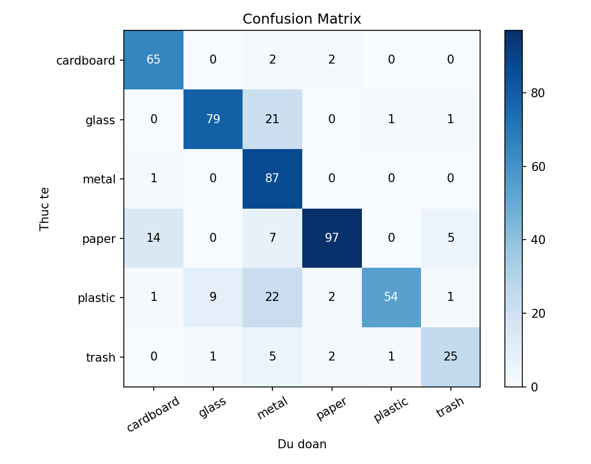

# Phân loại rác thải thông minh (Smart Waste Sorting)

Web nhận diện và phân loại 6 loại rác qua camera hoặc ảnh tải lên, dùng MobileNetV2 chạy trực tiếp trên trình duyệt bằng TensorFlow.js.

Link chạy thử: https://baolilo.github.io/smart-waste-sorting/

## Thông tin nhóm

\- Môn học: Học Máy (Machine Learning)  
\- Giảng viên hướng dẫn: ThS. Nguyễn Thái Anh  
\- Nhóm 12: Nguyễn Trần Khôi Vĩ, Châu Gia Bảo

## Chức năng chính

\- Nhận diện trực tiếp bằng camera (đổi camera trước/sau, lật gương, phóng toàn màn hình) hoặc tải ảnh từ máy lên.  
\- Kết hợp mô hình MobileNetV2 của nhóm với COCO-SSD (cắt sát vật thể) và MobileNetV2 ImageNet để hạn chế nhận nhầm nền.  
\- Làm mượt kết quả qua 5 khung hình liên tiếp, chỉ chốt khi vượt ngưỡng tin cậy (mặc định 70%).  
\- Hiện tỷ lệ dự đoán cho từng loại rác và gợi ý thùng rác tương ứng.  
\- Lưu thống kê, lịch sử phân loại trong phiên và hỗ trợ xuất file CSV.  
\- Có đọc kết quả bằng tiếng Việt, đổi giao diện sáng/tối và phím tắt (`Space` bật/tắt camera, `F` toàn màn hình, `T` đổi giao diện).

## Dữ liệu và kết quả mô hình

\- Bộ dữ liệu: TrashNet gồm 2.527 ảnh, chia thành 6 lớp (`cardboard`, `glass`, `metal`, `paper`, `plastic`, `trash`).  
\- Tỷ lệ chia: 80% huấn luyện (2.022 ảnh) và 20% kiểm thử (505 ảnh).  
\- Cách huấn luyện: Transfer Learning với MobileNetV2, đóng băng ở giai đoạn đầu rồi fine-tune 40 lớp cuối, sau đó xuất sang định dạng TensorFlow.js (`model.json` và các file `.bin`).  
\- Độ chính xác trên tập kiểm thử: 80,59% (407/505 ảnh đúng).

### Ma trận nhầm lẫn



## Cấu trúc thư mục

```text
smart-waste-sorting/
├── index.html
├── css/
│   └── style.css
├── js/
│   ├── config.js
│   ├── classifier.js
│   └── app.js
├── model/
│   ├── model.json
│   ├── group1-shard1of3.bin
│   ├── group1-shard2of3.bin
│   ├── group1-shard3of3.bin
│   ├── waste_mobilenetv2_finetuned.keras
│   ├── waste_mobilenetv2.h5
│   └── patch.py
├── confusion_matrix.png
├── .gitignore
└── README.md
```

## Cách chạy trên máy (Local)

Vì trình duyệt chặn tải model nếu mở thẳng file HTML và cần môi trường localhost để bật camera, chạy bằng server cục bộ:

```bash
git clone https://github.com/BaoLilo/smart-waste-sorting.git
cd smart-waste-sorting
python3 -m http.server 8000
```

Mở trình duyệt vào `http://localhost:8000` (hoặc mở bằng tiện ích Live Server trong VS Code).

## Công nghệ sử dụng

\- Python, TensorFlow / Keras (MobileNetV2)  
\- TensorFlow.js, COCO-SSD, MobileNet  
\- HTML, CSS, JavaScript  
\- GitHub Pages